<p align="center">
  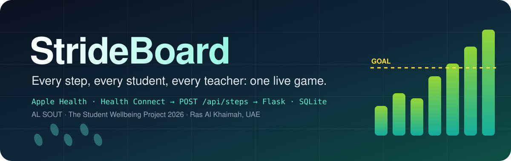
</p>

<p align="center">
  
  
  
  
  
  
  
  
</p>

<h3 align="center">A cross-platform, server-authoritative movement engine that turns a whole school's step counts into a live, fair, weekly game.</h3>

---

## ⚡ The pitch

Schools sit still. Students sit through six or seven lessons a day; teachers stand at a board, then sit through marking. Everyone *knows* they should move more, and almost nobody counts.

**StrideBoard counts for them, and then makes it a game.**

Every phone in the school already measures steps. StrideBoard reaches into that data through **two completely different health platforms**: Apple Health on iPhone (through an automated Shortcut) and Google Health Connect on Android (through a native Kotlin background worker). It streams daily totals through a single hardened REST endpoint into a **Flask + SQLite core**. There, a rules engine running on a timezone-locked clock turns raw numbers into:

- 🎯 **adaptive personal goals** that learn from each person's own 14-day rhythm,
- 🏆 **five live leaderboards**, including *effort* and *improvement* boards so the fittest person doesn't always win,
- 🥉🥈🥇💎 **weekly tiers** that reset every Monday, so anyone can climb,
- 🏅 **server-awarded badges** that unlock avatars,
- 🌍 **school-wide distance challenges** where every step from every person moves one shared progress bar,
- 🪞 a **Weekly Wrap-Up** that puts steps next to mood and writes each person one honest sentence about their week.

Then it shows it all on **one mobile-first website** that installs like an app: a native WebView shell on Android, a Home Screen PWA on iPhone, and a normal page in any browser.

No GPS. No weight. No BMI. No photos. Just steps, and a reason to take more of them.

> Built for **AL SOUT, The Student Wellbeing Project 2026** (Ras Al Khaimah, UAE, via RAKDOK), category **"Play, Code, Create: The AI Innovation Challenge"**, theme *Innovating for Everyday Wellbeing*.

---

## 📚 Contents

1. [Feature tour](#-feature-tour)
2. [The game](#-the-game)
3. [How it works](#-how-it-works)
4. [The algorithms](#-the-algorithms)
5. [Measuring real wellbeing impact](#-measuring-real-wellbeing-impact)
6. [Privacy and safety by design](#-privacy-and-safety-by-design)
7. [Tech stack](#-tech-stack)
8. [Repository layout](#-repository-layout)
9. [Run it on your own computer](#-run-it-on-your-own-computer)
10. [Connect your phone](#-connect-your-phone)
11. [Deploying](#-deploying)
12. [API reference](#-api-reference)
13. [Testing](#-testing)
14. [Honest limits](#-honest-limits)
15. [Team](#-team)

---

## 📱 Feature tour

<table>
  <tr>
    <td align="center" width="33%">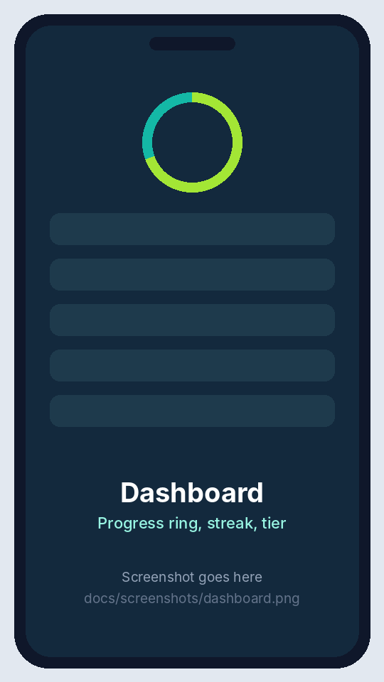<br><b>Dashboard</b></td>
    <td align="center" width="33%"><br><b>Leaderboards</b></td>
    <td align="center" width="33%">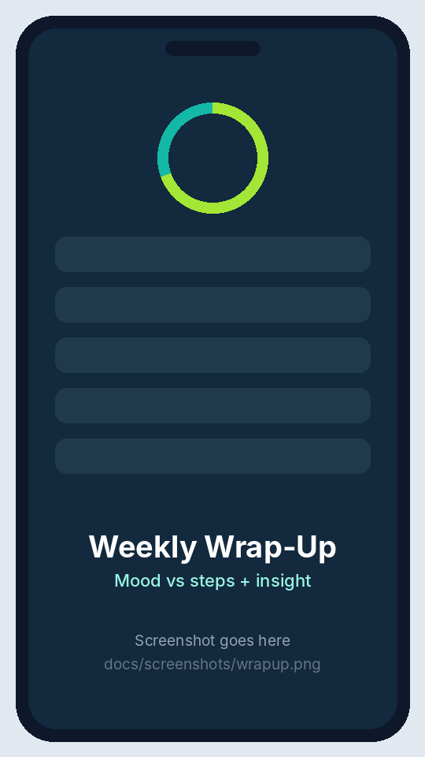<br><b>Weekly Wrap-Up</b></td>
  </tr>
  <tr>
    <td align="center">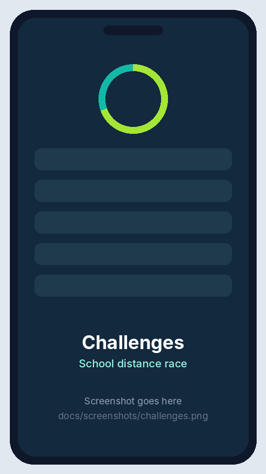<br><b>Challenges</b></td>
    <td align="center">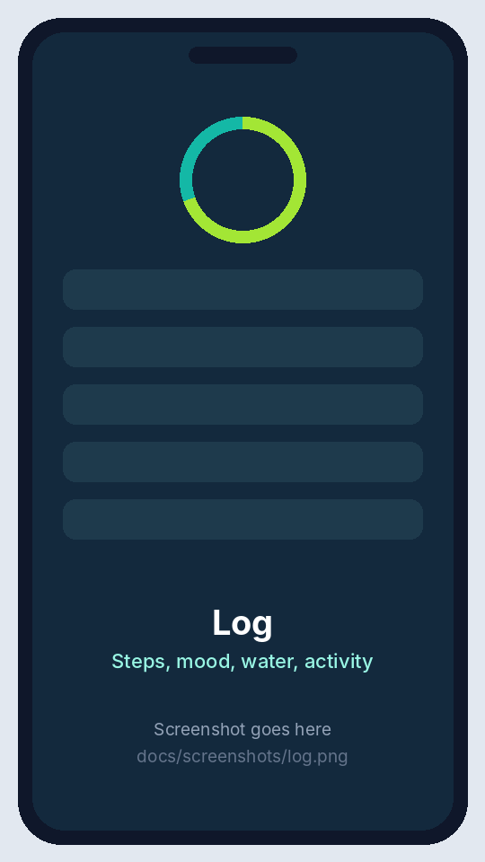<br><b>Log</b></td>
    <td align="center">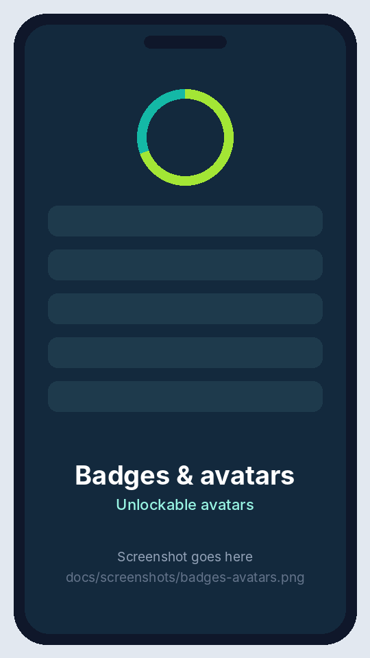<br><b>Badges &amp; avatars</b></td>
  </tr>
  <tr>
    <td align="center">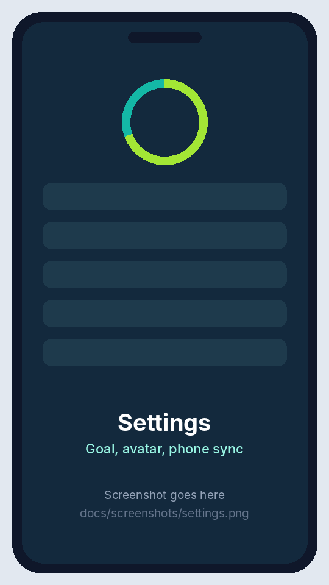<br><b>Settings</b></td>
    <td align="center">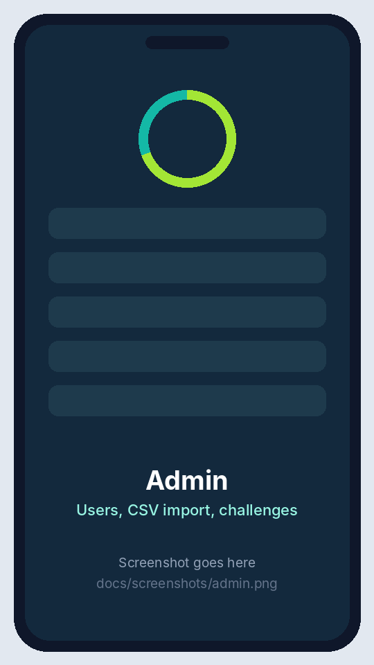<br><b>Admin</b></td>
    <td align="center">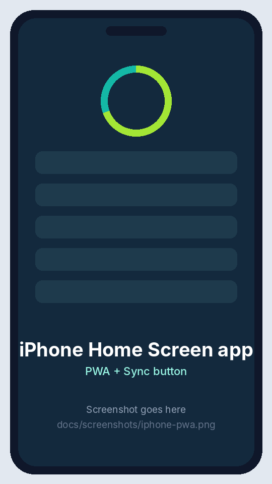<br><b>iPhone app (PWA)</b></td>
  </tr>
  <tr>
    <td align="center">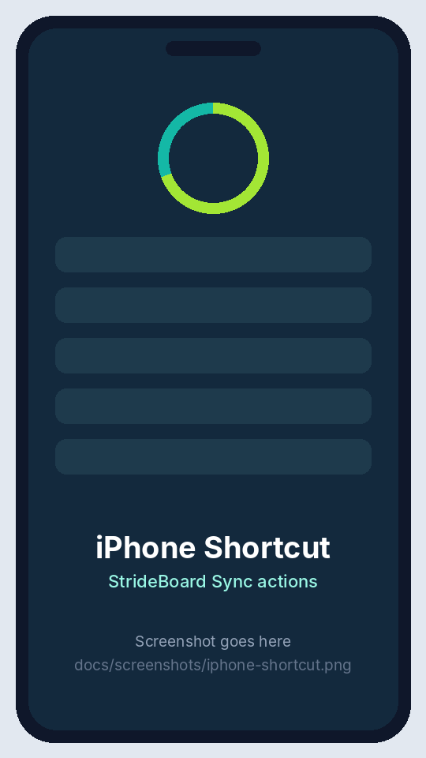<br><b>iPhone Shortcut</b></td>
    <td align="center">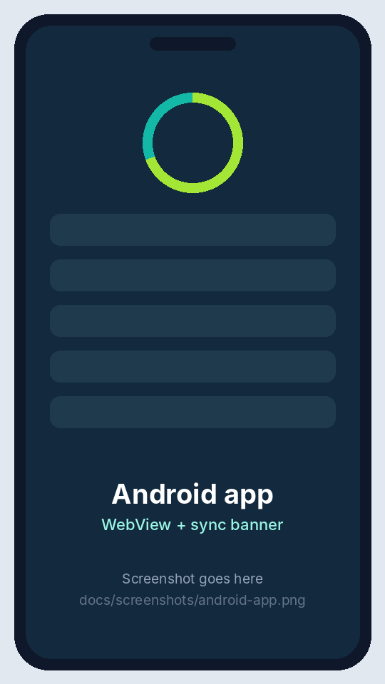<br><b>Android app</b></td>
    <td align="center">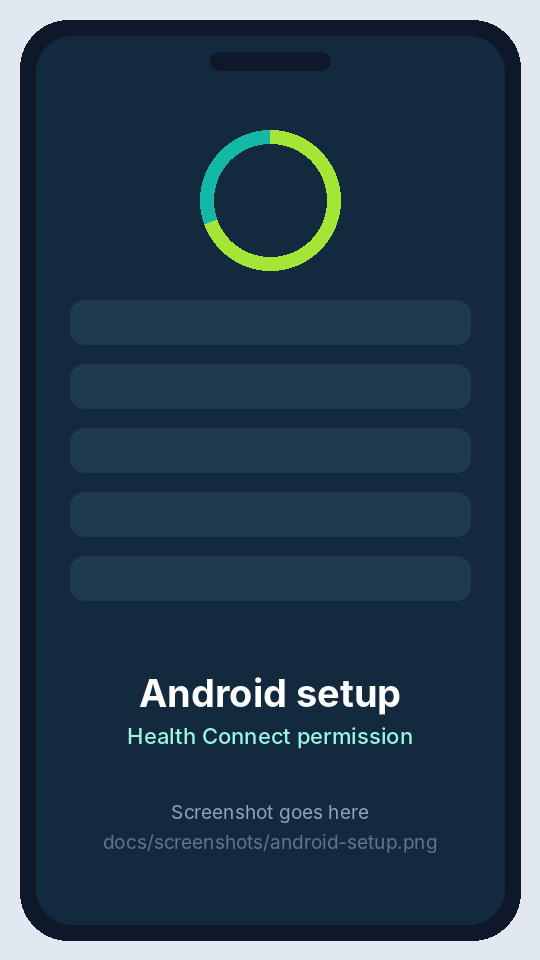<br><b>Android setup</b></td>
  </tr>
</table>

### 🏠 Dashboard: your day at a glance
- **Progress ring** that fills toward today's personal goal, with the step number counting up when the page opens.
- **Streak**: consecutive days you hit your goal (ending today or yesterday, so you never lose it before the day is over).
- **This week's total**, your **tier**, the **next tier** and exactly how many steps it is away.
- **One-tap mood check-in** (1 to 5) and a **water counter** (+/−), both saved instantly without reloading.
- A live **leaderboard preview** so you always know where you stand.
- On iPhone: a **"Sync from Apple Health"** button that runs the Shortcut and refreshes the page when you come back.

### 🏆 Leaderboards: five ways to win
| View | Ranks people by | Why it exists |
|---|---|---|
| **Teachers** | Total steps this week | The original idea: a staff step race |
| **Students** | Total steps this week | Same race, separate league |
| **Departments** | Average weekly steps per member | Science vs Maths vs PE; everyone in a department counts, even with 0 steps |
| **Effort** | % of your own weekly goal | Fair: a 6,000-step goal hit 120% beats a 10,000-step goal hit 90% |
| **Improvement** | % change vs the same days last week | Rewards getting better, not being the fittest |

Every board has a **podium** for the top 3, shows **avatars**, breaks ties in favour of whoever got there first, and never shows admins.

### 🌍 Challenges: the whole school, one goal
- **School distance challenge**: every step from every user is converted to kilometres (`steps × 0.0007`) and fills a shared progress bar along a real route, for example *Ras Al Khaimah → Dubai*.
- **Department challenge**: departments compete over a date window, with live standings.
- Admins create and close challenges. The server can **suggest a realistic distance target** from the number of active users.

### 🪞 Weekly Wrap-Up: the reflection stage
- **This week vs last week**, compared fairly (Monday-to-today against the same days last week).
- **Tier change** (for example *Silver → Gold*) and your **best day**.
- A **daily steps chart** and a **mood-vs-steps chart** (Chart.js).
- One **auto-generated insight sentence**, built from simple, explainable rules, for example:
  - *"You walked 18% more than last week. Nice."*
  - *"On days you hit your goal, your average mood was 4.2 vs 3.1 on other days."* (only shown once there are at least 3 days of mood data in each group).

### ✍️ Log: for everything the phone doesn't catch
Manual **steps** (for anyone without phone sync), **mood**, **water** and **activities** (walk, gym, sport, yoga, stretch, other) with minutes.

### 🏅 Badges and avatars
Seven badges, all awarded **on the server** when steps are saved, so they can't be faked from the browser. Each one unlocks an emoji avatar. Eight more animal avatars are free, in eight colours. There are no profile photos, because most users are minors.

### ⚙️ Settings
Your **personal sync token**, step-by-step **iPhone and Android setup**, your **age band**, a **custom daily goal**, and the **avatar picker**.

### 🛠️ Admin
Create and close challenges, view users, and **bulk-add a whole class from pasted CSV**:
```
username,display_name,role,department,age_band,pin
```

### 📲 Two native integrations, one app experience
| | iPhone | Android |
|---|---|---|
| **Reads steps from** | Apple Health | Google Health Connect |
| **How** | "StrideBoard Sync" Shortcut | Native Kotlin app + WorkManager |
| **When** | 07:00 and 21:30 automations + 1-tap button | Every 3 hours, ~23:30 nightly, and on app open |
| **The app itself** | Website added to the Home Screen (PWA) | Same website in a full-screen WebView |
| **Sends** | Yesterday's and today's totals | Yesterday's and today's totals |

Sending **yesterday as well as today** on every sync means late-evening steps are never lost. A **0 total is never sent**, so a hand-typed entry can't be wiped out by an empty sync.

---

## 🎮 The game

<p align="center">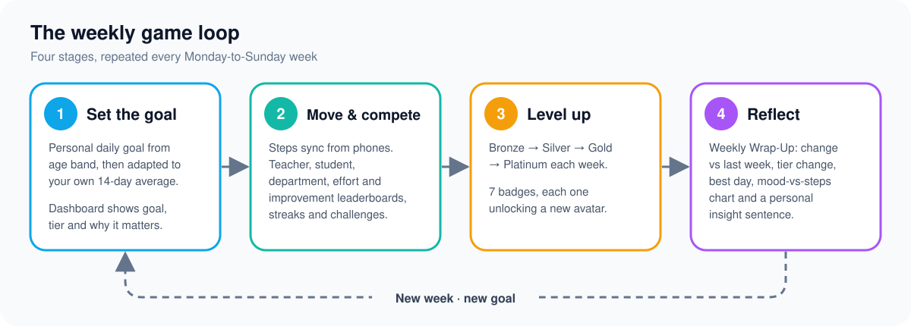</p>

The competition rules require at least three stages. StrideBoard has four, and they repeat every week:

| Stage | What happens | Where you see it |
|---|---|---|
| **1 · Set the goal** | A personal daily goal, your current tier, and one line on why movement helps wellbeing | Dashboard |
| **2 · Move and compete** | Steps arrive from phones; leaderboards, streaks, challenges and badges update live | Dashboard, Leaderboards, Challenges |
| **3 · Level up** | A new tier every week, badges that unlock avatars | Dashboard, Settings |
| **4 · Reflect** | Week vs last week, tier change, best day, mood-vs-steps chart, a personal insight | Weekly Wrap-Up |

### Tiers

<p align="center">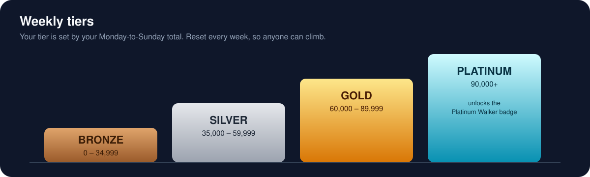</p>

### Badges

| Badge | Name | How to earn it | Unlocks |
|---|---|---|---|
| `first_log` | First Steps | Your first steps entry | 👟 sneaker |
| `ten_k` | 10K Club | 10,000+ steps in one day | ⭐ star |
| `streak_3` | On a Roll | 3-day goal streak | 🔥 fire |
| `streak_7` | Unstoppable | 7-day goal streak | 🚀 rocket |
| `consistent` | Consistent Logger | Steps on 5 different days in one week | ⚡ bolt |
| `comeback` | Comeback Kid | A week 25%+ above the last (last week at least 10,000) | 🦁 lion |
| `platinum` | Platinum Walker | Reach Platinum in a week | 👑 crown |

---

## 🧠 How it works

<p align="center">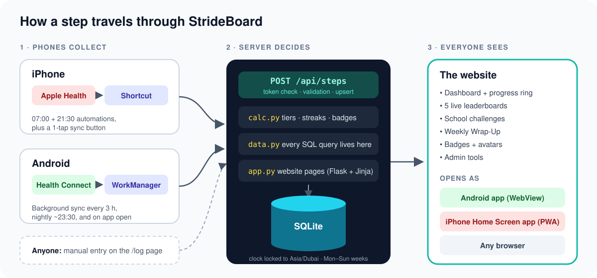</p>

1. **Phones collect.** The iPhone Shortcut asks Apple Health for step samples **grouped by day**, so Health itself merges phone and Apple Watch data without counting anything twice. The Android app calls Health Connect's `aggregate()` with `StepsRecord.COUNT_TOTAL` over exact Dubai-time day boundaries.
2. **The server decides.** Each phone sends `{token, date, steps, source}` to `POST /api/steps`. The server identifies the person by their secret token, validates every field, **upserts** one row per person per day (a newer total replaces the older one), then recalculates their week, tier and badges.
3. **Everyone sees.** The website reads everything through one data layer (`data.py`) and renders it with server-side Jinja templates. There is no front-end framework and no build step: plain HTML, CSS, a little vanilla JavaScript and Chart.js.

**Design rules the whole codebase follows:**
- **One source of truth for time.** "Today" is always `datetime.now(ZoneInfo("Asia/Dubai"))`, never the server's clock (cloud servers run in UTC, which would shift the school day by four hours).
- **All SQL lives in one file** (`data.py`), always parameterised.
- **Pure game maths** (`calc.py`) has no database access at all, so every rule is unit-tested in isolation.
- **The server is authoritative.** Badges, tiers and streaks are never trusted from a client.

---

## 📐 The algorithms

### Adaptive daily goal
New users start from an age-band goal. Once someone has **14+ days of data**, their goal adapts to them every Monday:

```
goal = round_to_nearest_250( average_of_last_14_days × 1.10 )
goal = clamp(goal, 3,000, 15,000)
```

In words: *"a little more than you usually do"*. It's always reachable, and it always nudges you up. If you set your own goal on the Settings page, the system never overrides it.

| Age band | Starting goal* |
|---|---|
| Under 13 | 11,000 |
| 13 to 17 | 10,000 |
| 18 to 39 | 8,000 |
| 40 to 59 | 8,000 |
| 60+ | 6,000 |

<sub>*Starting values are being checked against current WHO guidance. Goals are general suggestions, not medical advice.</sub>

### Leaderboard maths
```
effort       = weekly_steps / (daily_goal × 7)
improvement  = (this_week_so_far − same_days_last_week) / same_days_last_week
department   = sum(member weekly steps) / number of members   (members with no steps count as 0)
distance_km  = total_steps_of_everyone_in_window × 0.0007
```
Ties go to the person whose latest update came **first**.

### Streaks
Count back from today (or from yesterday, if today's goal isn't reached yet) while `steps ≥ daily_goal`.

### Input hardening on `/api/steps`
The endpoint accepts what real phones actually send and rejects everything else:
- `"8423"`, `8423.4` and Arabic-Indic digits like `"٨٤٢٣"` are all accepted (decimals are rounded);
- negative numbers, anything over 100,000, future dates, dates over 7 days old, unknown sources and non-JSON bodies are rejected with a readable reason;
- request bodies over 16 KB are refused.

---

## 📈 Measuring real wellbeing impact

The rules ask every project to show how its data shows real impact. StrideBoard measures it directly from the database (`data.impact_stats`):

| Measure | What it shows |
|---|---|
| **Average daily steps before vs during** | Phones keep step history, so a person's first sync captures up to 7 days *before* they joined. That gives a real baseline to compare against. |
| **People hitting their goal** | How many users reach their personal goal on a typical day |
| **Mood on goal days vs other days** | Whether people report feeling better on days they move more |
| **Automatic vs manual entries** | How much of the data comes straight from phones (reliable) vs typed in |
| **Improvement leaderboard** | Week-on-week change across the school |

We report these honestly: a short school trial can show **association**, not proof of cause, and we say so in the demo.

---

## 🔒 Privacy and safety by design

Many users are minors, so StrideBoard collects the minimum:

| Collected | Not collected |
|---|---|
| Daily step totals | Location / GPS |
| Optional mood (1–5), water, activity minutes | Weight, height, BMI |
| Age **band** (not exact age) | Exact age or date of birth |
| Department or class | Photos, contacts, email |

- **Leaderboards show only** display name, department and a total. Detailed history is visible only to its owner.
- **PINs are hashed** (Werkzeug). Phone tokens are random (`secrets.token_urlsafe(24)`), treated as passwords, never logged and never shown anywhere except the owner's own Settings page.
- **HTTPS only** in production. The Android release build refuses plain HTTP.
- **Parameterised SQL**, Jinja autoescaping on, every input validated on the server.
- The Android app reads **only step totals**, and says so on its own privacy screen.
- The school decides whether leaderboards use real names or nicknames.

---

## 🧰 Tech stack

| Layer | Technology |
|---|---|
| Server | Python 3.10+, Flask 3, built-in `sqlite3` (no ORM) |
| Website | Jinja templates, plain CSS, vanilla JS, Chart.js (CDN), mobile-first |
| iPhone app experience | PWA: `manifest.json`, icons, service worker with offline fallback |
| iPhone steps | Apple Shortcuts + Apple Health |
| Android | Kotlin, Android Studio, Health Connect, WorkManager, WebView |
| Tests | pytest (157 tests) |
| Hosting | PythonAnywhere (HTTPS) |

---

## 🗂️ Repository layout

```
StrideBoard/
├── server/
│   ├── app.py          website routes and pages (Flask)
│   ├── api.py          POST /api/steps (Flask Blueprint)
│   ├── data.py         the data layer: every SQL query lives here
│   ├── calc.py         pure game maths: weeks, tiers, streaks, goals, badges, insights
│   ├── db.py           connections, schema upgrades, Dubai clock, CLI commands
│   ├── config.py       tiers, goals, badges, avatars, limits
│   ├── schema.sql      database tables
│   ├── seed.py         demo data or a clean admin-only start
│   ├── devapp.py       API-only app for testing
│   ├── templates/      Jinja pages
│   ├── static/         CSS, JS, PWA manifest, service worker, icons
│   └── tests/          pytest suite
├── android/            Kotlin app: WebView shell + Health Connect sync (see android/README.md)
├── ios/                how to build the "StrideBoard Sync" Shortcut (see ios/README.md)
├── docs/               images and screenshots for this README
├── requirements.txt
└── README.md
```

---

## 💻 Run it on your own computer

You need **Python 3.10 or newer** and **Git**.

```bash
git clone https://github.com/SohamBhongade/StrideBoard.git
cd StrideBoard

python -m venv .venv
# Windows (PowerShell):  .venv\Scripts\Activate.ps1
# macOS / Linux / Git Bash:  source .venv/bin/activate

pip install -r requirements.txt

cd server
python seed.py              # fills a local database with clearly fake demo users and 14 days of steps
flask --app app run         # open http://127.0.0.1:5000
```

Log in locally with one of the fake demo accounts that `seed.py` creates, for example **student1** or **teacher1** (PIN `1234`).

Useful extras:
```bash
python seed.py --reset              # wipe and reseed the demo data
python seed.py --reset --admin-only # clean start for real users (prints a new admin PIN)
flask --app devapp show-token student1   # print a test token for phone testing (keep it private)
```

---

## 📲 Connect your phone

### iPhone (about 2 minutes once the Shortcut is shared)
1. Open the **StrideBoard Sync** iCloud link (on the website's Settings page) → **Add Shortcut** → paste your token from Settings.
2. Run it once and allow **Steps** access.
3. Shortcuts → **Automation** → **+** → **Time of Day 21:30, Daily** → **Run Immediately** → StrideBoard Sync. Repeat for **07:00**.
4. In Safari, open the website → **Share → Add to Home Screen**.

Full build guide: [`ios/README.md`](ios/README.md).

### Android
1. Install the StrideBoard APK (download link on the Settings page).
2. Enter the website address and your token → **Allow step access** → **Sync now**.
3. Set battery usage for StrideBoard to **Unrestricted** so background sync keeps running.

Build and testing guide: [`android/README.md`](android/README.md).

---

## 🚀 Deploying

StrideBoard runs on **PythonAnywhere** with HTTPS forced.

1. Upload the repository's `server/` folder to `~/strideboard/server`, create a virtualenv and run `pip install -r requirements.txt`.
2. Set the `SECRET_KEY` and database-path environment variables (names in `server/config.py`). Keep the database **outside** the code folder.
3. Point the WSGI file at `app.py` (`from app import app as application`) and click **Reload**.
4. Before real users join, run `python seed.py --reset --admin-only` and store the admin PIN safely.
5. On the free plan, open the Web tab and click the button that extends the app before it expires (and again before the demo).

---

## 🔌 API reference

### `POST /api/steps`
```json
{ "token": "<your api_token>", "date": "2026-10-14", "steps": 8423, "source": "ios_shortcut" }
```

| Field | Rules |
|---|---|
| `token` | Required. The person's secret token from Settings |
| `date` | Optional (`YYYY-MM-DD`, Dubai time). Default today. Not in the future, at most 7 days ago |
| `steps` | 0 to 100,000. Decimals rounded. Numeric strings and Arabic-Indic digits accepted |
| `source` | `manual`, `ios_shortcut`, `android_app` or `other` |

| Reply | Meaning | Phone should |
|---|---|---|
| `200 {"ok": true, "weekly_total": 41230, "tier": "Silver"}` | Saved | Show "synced" |
| `400 {"ok": false, "error": "..."}` | Bad input | Show the reason, don't retry |
| `401 {"ok": false, "error": "invalid token"}` | Wrong token | Ask for a new token |
| `413 {"ok": false, "error": "request is too large"}` | Body over 16 KB | Don't retry |
| Network error / 5xx | Server unreachable | Retry later |

Example (Git Bash or macOS Terminal):
```bash
curl -X POST https://<your-server>/api/steps \
  -H "Content-Type: application/json" \
  -d '{"token":"PASTE_YOUR_TOKEN","steps":8423,"source":"ios_shortcut"}'
```

---

## 🧪 Testing

```bash
python -m pytest server/tests -q
```

The suite covers week boundaries (Sunday night vs Monday morning), tier edges (exactly 35,000), streaks, adaptive goals, ties, empty weeks, every badge, every leaderboard, and every API error: bad token, future date, 8 days ago, `-1`, `100001`, `"9,500.0"`, Arabic digits, unknown source and non-JSON bodies.

---

## 🧭 Honest limits

- **iPhone sync isn't continuous.** iOS hides Health data while the phone is locked, so a timed automation can occasionally miss. The 1-tap Sync button and the twice-daily schedule cover this.
- **Android background sync depends on the phone.** Some phones pause background work to save battery. The app also syncs whenever it's opened.
- **The Android app is sideloaded** (no Play Store), and there is no native iPhone app; iPhone uses the PWA.
- **Insights are rule-based**, which makes them explainable. They show patterns, not medical advice.

---

## 👥 Team

StrideBoard was created by **the StrideBoard team** (its members are named in [LICENSE](LICENSE)),
supervised by **Ahamed Kaleel**.

© 2026 The StrideBoard team. All rights reserved. See [LICENSE](LICENSE): no part of StrideBoard may be copied,
reused or hosted elsewhere without the team's written permission.

Built with AI coding assistants, as the competition category intends. The team planned the design, split the work into three parts with fixed interfaces, reviewed and tested the code, and ran it with real users.

---

<p align="center"><i>This app is for fun and motivation. Goals are general suggestions, not medical advice.</i></p>

## Backups and restoring

`server/backup.py` copies the database safely (SQLite's own backup, so it's consistent even
while phones are syncing), compresses it and **encrypts it (AES-256-GCM)**. It reads the
site's settings (database path, Gmail, keys) from the WSGI file, so the task needs no setup.

- **Daily:** on PythonAnywhere, Tasks tab, add a daily task:
  `python3 /home/strideboard/strideboard/server/backup.py`
  It saves into `strideboard-data/backups/` next to the database and keeps the last 7 days.
  On Mondays it also emails the copy to the site's Gmail (an off-site copy). Delete those
  emails after 4 weeks (the privacy policy promises this).
- **Any time:** the owner can click **Admin → Backups → Download a backup** (not encrypted:
  it goes straight to the owner's computer over HTTPS).
- **The key:** `STRIDEBOARD_BACKUP_KEY` (64 hex characters) if set in the WSGI file, otherwise
  one made from `STRIDEBOARD_SECRET_KEY`. If you change the secret key, older copies can only be
  opened with the old one, so set a separate backup key if you want one key for good.

**To restore** (Bash console on PythonAnywhere):

```
cd ~/strideboard-data
cp strideboard.sqlite3 strideboard-before-restore.sqlite3     # keep the current one, just in case
python3 ~/strideboard/server/backup.py --decrypt backups/strideboard-backup-YYYY-MM-DD.sqlite3.gz.enc strideboard.sqlite3
touch /var/www/strideboard_pythonanywhere_com_wsgi.py
```

(For a downloaded or emailed backup, upload the `.gz` file first, then use its name instead.)
